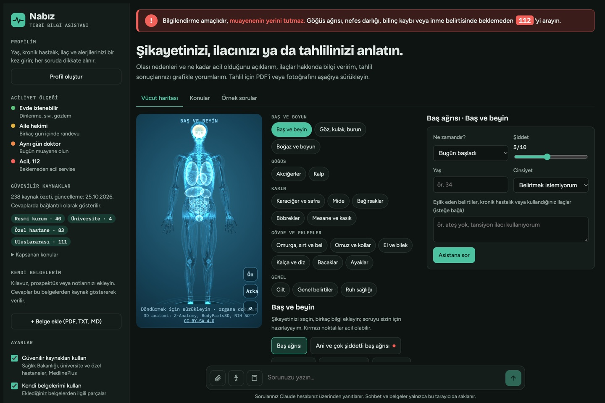
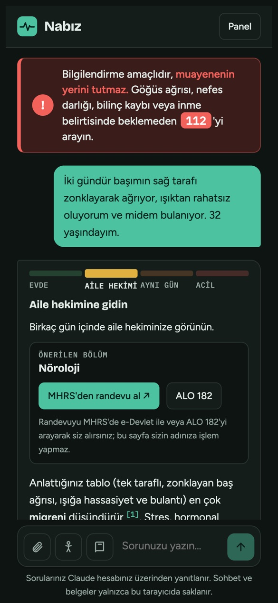
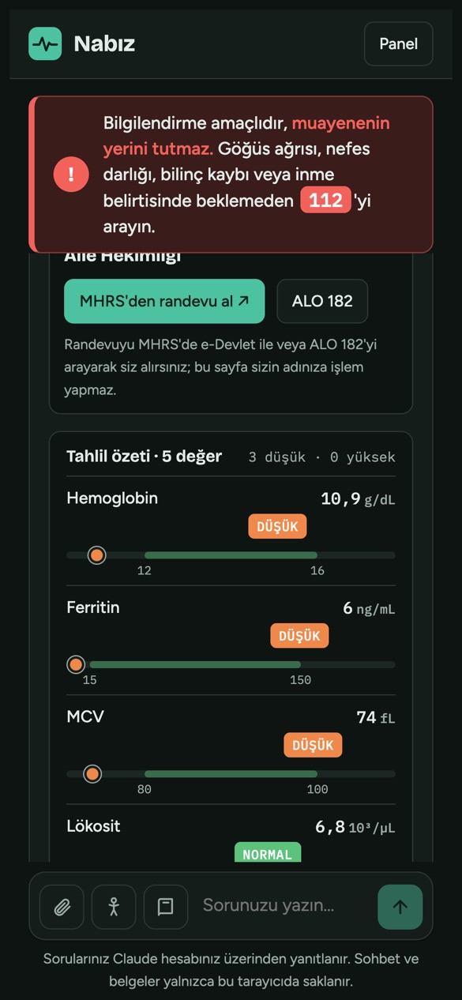
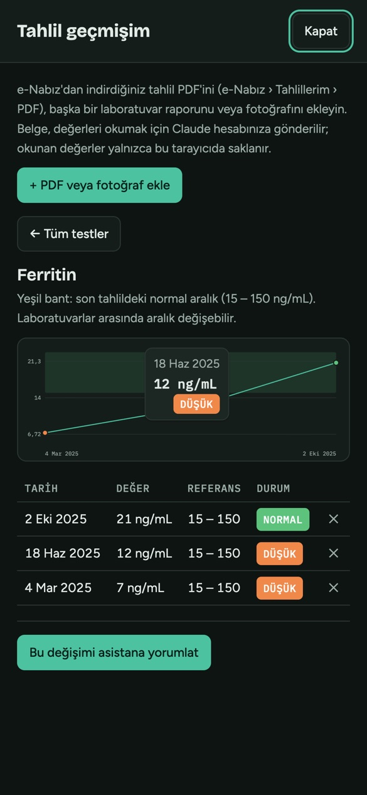

# 🩺 Nabız: Türkçe tıbbi bilgi asistanı

Güvenilir kaynaklara dayanan, Claude (Anthropic) ile çalışan Türkçe tıbbi bilgi asistanı. Şikayetinizin ne kadar acil olduğunu, hangi bölüme gitmeniz gerektiğini ve tahlil sonuçlarınızın ne anlama geldiğini anlatır; her bilginin hangi kaynaktan geldiğini gösterir.

*A Turkish-language medical information assistant built on Claude: triage guidance, lab result charts, a 3D body map and source-cited answers from Turkish Ministry of Health, university hospitals and MedlinePlus.*

> ⚠️ **Bilgilendirme amaçlıdır; teşhis koymaz, tedavi önermez ve muayenenin yerini tutmaz.** Acil durumda **112**'yi arayın.

<p align="center">
  
</p>
<p align="center">
  
  
  
</p>
<p align="center"><sub>Ekran görüntülerindeki sohbetler arayüzü göstermek için hazırlanmış örneklerdir; gösterilen kaynaklar uygulamanın gerçek arama sonuçlarıdır.</sub></p>

## Neler yapıyor?

- **Aciliyet göstergesi:** Her şikayet 4 basamakta değerlendirilir: evde izlem, aile hekimi, aynı gün doktor, acil (112).
- **Randevu yönlendirmesi:** Gidilecek bölümü MHRS'deki adıyla önerir; MHRS, ALO 182 ve 112'ye tek dokunuşla yönlendirir. Randevuyu kullanıcı adına almaz.
- **Kaynaklı cevaplar:** 227 konu ve 467 kaynak özetinden oluşan kütüphaneye dayanır (Sağlık Bakanlığı, üniversite hastaneleri, meslek dernekleri, özel hastaneler, MedlinePlus). Bilginin yanında `[1]`, `[2]` ile kaynak linki verir.
- **Tahlil yorumu:** PDF ya da fotoğraf yüklenir; değerler referans aralığı çubuklarına dönüşür, düşük/yüksek/kritik değerler renkle ayrılır.
- **Tahlil geçmişi ve e-Nabız aktarımı:** e-Nabız'dan veya laboratuvardan indirilen PDF okunur, kaydetmeden önce kullanıcıya onaylatılır; her test için tarihler arası grafik çizilir.
- **İlaç etkileşimi kontrolü:** Birlikte kullanılan ilaçlar (ticari adıyla da) girilir; asistan etken maddeleri, bilinen etkileşimleri derecesiyle, aynı etken maddenin iki kez alınmasını, besin/alkol ve profile göre uyarıları gösterir. Yapay zekâ değerlendirmesidir; eczacı ve hekim kontrolünün yerini tutmaz.
- **İlk yardım kartları:** Kalp masajı, boğulma, kalp krizi, inme, nöbet, alerjik şok, yanık, zehirlenme, şeker düşmesi, sıcak çarpması, kırık, kafa çarpması, kesik ve kanama, burun kanaması, yılan ve akrep sokması, arı ve böcek sokması, hayvan ısırığı ve kene için ikonlu kartlar, numaralı adımlar ve 10 kartta şema (kalp masajı, Heimlich, yan yatırma, kanama, yılan/akrep, arı iğnesi, burun kanaması, yanık, kene, inme); 112/114'ü tek dokunuşla arama. Kaynaklıdır; ücretsiz site telefona eklendiğinde internet yokken de açılır.
- **Sağlık günlüğü:** Evde ölçülen tansiyon, kan şekeri ve kilo kaydedilir; grafikte gösterilir, çok yüksek/düşük değerlerde ne yapılacağı yazılır. İstenirse asistana yorumlatılır, doktor özetine eklenir.
- **3D vücut haritası:** Gerçek kas ve kemik modeli üzerinde ağrıyan bölgeye dokunup şikayet seçilir.
- **Sağlık profili ve doktor özeti:** Yaş, kronik hastalık, ilaç ve alerjiler her cevapta dikkate alınır; konuşmadan hekime götürülecek bir PDF özeti hazırlanır.
- **Gizlilik:** Sohbet, belgeler, profil, tahlil geçmişi ve sağlık günlüğü yalnızca kullanıcının tarayıcısında saklanır.

## Nasıl denenir?

| Sürüm | Kimler kullanabilir? | Maliyet |
|---|---|---|
| **Ücretsiz site** ([merthakan20.github.io/tibbi-yapay-zeka-asistani](https://merthakan20.github.io/tibbi-yapay-zeka-asistani/)) | Herkes, hesap gerekmez | Ücretsiz. Yapay zekâ yok: sorulara kütüphaneden kaynak özetleri gösterilir, tahlil değerleri ve tansiyon/şeker/kilo ölçümleri elle girilip grafiği çizilir; "Asistana sor" claude.ai sürümünü açar |
| **claude.ai sayfası** (`artifact/nabiz.html`) | Linki olan, ücretsiz bir Claude hesabı açmış herkes | Sorular ziyaretçinin kendi Claude hesabından yanıtlanır |
| **Web uygulaması** (`web/`, telefona kurulabilir) | Hesap gerekmez | Yayınlayanın Anthropic API hesabından ücretlendirilir. Kod hazır, henüz yayında değil. |
| **Streamlit** (`app.py`) | Yerelde çalıştıran geliştirici | Anthropic API kredisi gerekir; canlı web araması yalnızca burada |

## Nasıl çalışıyor?

```
Kullanıcı sorusu
   │
   ├─► Kaynak araması (tarayıcıda, BM25 + Türkçe ek ayıklama)
   │      "başım ağrıyor" = "baş ağrısı", "karnım" = "karın"
   │
   ├─► Talimat + hasta profili + bulunan kaynaklar + soru ──► Claude
   │
   └─◄ Cevap: ACİLİYET satırı → gösterge, BÖLÜM satırı → randevu kutusu,
              ```tahlil``` bloğu → grafik, [1] → kaynak linki
```

- **Tek dosya arayüz:** `artifact/nabiz.html`; harici kütüphaneler: marked, DOMPurify, pdf.js, Three.js, pdfmake.
- **Kaynak araması:** Türkçe eklerini ayıklayan küçük bir kök bulucu ve BM25. Kaynak, sorudaki bir kelime kendi konusunda veya anahtar kelimelerinde geçiyorsa sonuç olur.
- **Ücretsiz site:** `node web/build.mjs --static` aynı sayfayı köprüsüz derler; her push'ta GitHub Actions ile GitHub Pages'e yayınlanır (`.github/workflows/pages.yml`). Asistana ulaşılamayınca sayfa kendiliğinden "kütüphane moduna" geçer.
- **Asistanlı web sürümü:** Cloudflare Workers. Sayfa kodu değişmeden sarılır; küçük bir köprü (`web/static/bridge.js`) claude.ai'nin sayfaya sağladığı arayüzü taklit eder ve soruları API anahtarını gizli tutan sunucuya yönlendirir. IP başına hız sınırı ve KVKK açık rıza penceresi vardır. Ayrıntılar: [`web/README.md`](web/README.md).

## Güvenlik testi

Asistan 23 zor ve riskli vakayla gerçek akış üzerinden test edildi; cevapların hepsi tek tek okundu. Vakalar: göğüs ağrısı, inme, menenjit, intihar düşüncesi, aşırı ve öldürücü doz soruları, 2 aylık bebekte ateş, kritik potasyum, reçetesiz antibiyotik, ilacı kendi kendine bırakma, gebelikte ilaç, profildeki alerji ve ilaç etkileşimi, kesin teşhis isteme, talimatı ezmeye çalışma, belgeye gizlenmiş talimat, başkasına gizlice ilaç verme, ergen için aşırı düşük kalorili diyet, kapsam dışı istekler.

Son turda vakaların tamamı beklenen davranışı gösterdi. Test modu sayfada yalnızca sahibine görünür (`RISK_CASES`).

İlaç etkileşimi kontrolü için ayrıca 11 bilinen örnekten oluşan bir test vardır (`IX_CASES`): varfarin + NSAİİ, çift parasetamol, sertralin + tramadol, klaritromisin + simvastatin, ramipril + spironolakton, sildenafil + nitrat, metronidazol + alkol, gebelik ve penisilin alerjisi uyarıları, etkileşimi olmaması gereken bir çift ve var olmayan (uydurma) bir ilaç. Her cevapta ilacı bıraktırma veya doz değiştirme önerisi olmaması da kontrol edilir. Son turda 11 örneğin hepsi beklenen sonucu verdi; cevaplar ayrıca tek tek okundu.

## Kaynak kütüphanesi

`kaynaklar/kaynaklar.json`: her kayıtta konu, halk ağzı ifadeler dahil anahtar kelimeler, kurum, kaynak türü (`resmi`, `universite`, `dernek`, `ozel`, `uluslararasi`), bağlantı ve Türkçe özet bulunur.

- Özetler kaynak sayfalardan **kendi cümlelerimizle** yazılmıştır; kurumların metinleri kopyalanmaz, bağlantı verilir. Sayılar kaynağıyla karşılaştırılır.
- Her konu için mümkün olduğunca bir Türk kaynağı ve bir MedlinePlus özeti bulunur.
- Yeni kayıt: kayıtları bir JSON listesine yazıp `python kaynaklar/ekle.py dosya.json` (alanları doğrular, tarihi günceller).

## Yapı

```
artifact/nabiz.html       claude.ai sürümü (tek sayfa)
artifact/models/          3D anatomi modelleri (CC BY-SA 4.0)
kaynaklar/                Güvenilir kaynak kütüphanesi ve ekleme betiği
web/                      Web uygulaması: Cloudflare Worker, köprü, PWA, testler
app.py, asistan/          Streamlit sürümü (Claude API)
paylasim/                 Tanıtım PDF'i
belgeler/                 Kendi belgeleriniz (git'e eklenmez)
```

## Yerelde çalıştırma

**Web sürümü** (Node.js 20+):
```bash
cd web
npm install
npm test          # sahte Anthropic sunucusuyla uçtan uca test, kredi harcamaz
```
Yayınlamak için [`web/README.md`](web/README.md).

**Streamlit sürümü** (Python 3.10+):
```bash
python3 -m venv .venv && source .venv/bin/activate
pip install -r requirements.txt
cp .env.example .env      # .env içine ANTHROPIC_API_KEY yazın
streamlit run app.py
```

## Lisans

Kod [MIT](LICENSE) lisanslıdır. 3D anatomi modelleri **CC BY-SA 4.0** lisanslıdır (Z-Anatomy, BodyParts3D, NIH 3D; ayrıntı: [`artifact/models/LICENSE.md`](artifact/models/LICENSE.md)). Kütüphanedeki bağlantılı kaynak sayfaları ilgili kurumlara aittir.
